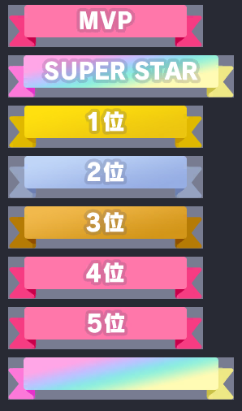

# 多人演出的结算画面 + MVP（原作实测规格）

> 2026-11-21 逆向日服 7.1.0。证据：`dump.cs`（TypeDefIndex / RVA）、
> `libil2cpp_arm64.so`（capstone）、AssetRipper 读 prefab / AnimationClip、`tex_all_sprite/` 逐像素。
>
> **一句话结论：谁拿 MVP 由服务器决定（`mvpFlg` 字段），客户端只负责显示。**
> 显示分两层：玩家卡上顶一条 **240×52 的缎带**，外加一个 **0.333s 的星星爆闪**。

---

## 0 三条最重要的结论（先看这个）

1. **MVP 不是客户端算的。** 服务器在 `UserMultiLiveClearScoreResponse` 里下发
   `mvpFlg` 和 `superStarFlg`（JSON key 就叫 `mvpFlg` / `superStarFlg`），
   客户端 `Setup()` 只做 `GameObject.SetActive(flag)`。
   → **我们做多人时，MVP 得由主控（房主）算完再广播，不能各端自己算。**
2. **"MVP" 和 "SUPER STAR" 是两个独立标记**，可以同时出现，缎带不同
   （粉色 MVP / 彩虹 SUPER STAR）。
3. **自定义房还有一套「技术排名」缎带 1位~5位**，和 MVP 互斥地占同一个位置，
   靠 `customRoomTechnicalRank` 切 sprite。

---

## 1 资源清单（已 dump 到本地）

### 1.1 Prefab

| prefab | PathID | 是什么 |
|---|---|---|
| `ScreenLayerMultiLiveResult` | **666** | 多人结算整个屏幕（2154 个节点） |
| `ScreenMultiLiveResultMemberScoreSummaryPlayerCell` | 1182 | 第一段 summary 的**头像格**（5 个） |
| `MultiLiveResultMemberScoreDetailPlayerCell` | **1193** | 第二段 detail 的**玩家卡**（336×632，MVP 缎带在这里） |
| `fx_result_MVP` | **1428** | MVP 星星爆闪（一次性） |
| `fx_result_SuperStar` | **1424** | SUPER STAR 版，结构和 MVP 完全同构 |
| `fx_result_MVP_loop` | 1427 | MVP 缎带常驻（循环，静止） |

`fx_result_rank_1`~`5` 是**同一套模板的克隆**（在玩家卡 1193 里内联），
缎带节点还叫 `MVP`，只是 sprite 换成 `ribbon_h40_1st`~`5th`。

**模板长这样**（MVP / SuperStar / rank 全是它）：

```
fx_result_XXX      100×100
├ root             100×100   （Image + Animator）
├ EffectRoot       100×100   ← CanvasGroup，动画改 alpha / sizeDelta
│ ├ kira_l1   20×20           ┐ 4 颗星，各带 60×60 辉光 eff_kira_glow_h24_wh_yw
│ ├ kira_l2   20×20           │ 位置是手摆的、不对称
│ ├ kira_r1   20×20           │
│ └ kira_r2   20×20           ┘
└ <缎带节点>                   ← MVP: 240×52 / SuperStar: 278×52
```

**MVP vs SuperStar 的差别只有两处**（其余逐字段相同）：

| | 缎带节点名 | sprite | 尺寸 | kira_l1 | kira_r1 |
|---|---|---|---|---|---|
| `fx_result_MVP` | `MVP` | `ribbon_h40_mvp` | **240×52** | `-87.9` | `93.92` |
| `fx_result_SuperStar` | `SuperStar` | `ribbon_h40_superstar` | **278×52** | `-107.6` | `113.86` |

星星跟着缎带一起往外推了约 20px —— 因为缎带宽了 38px。

### 1.2 贴图（都在 `tex_all_sprite/`，共 2808 张里的一族）

| 文件 | 尺寸 | 内容 |
|---|---|---|
| `ribbon_h40_mvp.png` | **240×52** | 粉色缎带 + 白字 `MVP` |
| `ribbon_h40_superstar.png` | **278×52** | 彩虹缎带 + 白字 `SUPER STAR` |
| `ribbon_h40_1st.png` … `5th.png` | **240×52** | 金/银/铜/粉/粉 + `1位`…`5位` |
| `ribbon_h40_rainbow.png` | 278×52 | 空彩虹带（给自定义文字） |
| `ribbon_h40_pk.png` | 78×52 | 小号粉带 |
| `MVP.png` | **346×56** | 金星大 `MVP`（带两侧小星）← 爆闪/常驻用 |
| `text_MVP.png` | 344×50 | 同上，纯文字层 |
| `text_MvpSUPERSTAR.png` | **184×56** | 紫字 `MVP` + `SUPER STAR` 两行 |
| `MVP_flash_01.png` | **150×243** | 竖向镜头光斑（加法混合） |

样张：　

（上：`ribbon_h40_mvp` / `superstar` / `1st`~`5th` / `rainbow`；
下：`ribbon_h40_mvp` / `MVP.png` / `text_MVP.png` / `text_MvpSUPERSTAR.png` / `MVP_flash_01.png`）

### 1.3 动画

| 资源 | 说明 |
|---|---|
| `ac_result_MVP` / `ac_result_MVP_loop` | AnimatorController（两个） |
| `clip_result_MVP` | **0.3333s @ 60fps**，一次性爆闪 |
| `clip_result_MVP_loop` | **LoopTime=1**，全程常量（只是"保持可见"） |

---

## 2 MVP 缎带的位置与结构

### 2.1 挂在玩家卡的**顶边**

detail 玩家卡 `MultiLiveResultMemberScoreDetailPlayerCell` = **336×632**，
里面预置了**一整套** `fx_result_*` 容器，**全部** 在 `pos = (0, 318)`、尺寸 100×100：

```
MultiLiveResultMemberScoreDetail   336×632          ← 玩家卡根
├ PlayerFrameCell                  4×596 @ (0,-296)  ← 卡框（按 frameId 换部件）
├ fx_result_MVP                100×100 @ (0, 318)    ← MVP 爆闪
├ fx_result_SuperStar          100×100 @ (0, 317.2)  ← SUPER STAR
├ fx_result_rank_1..5          100×100 @ (0, 318)    ← 自定义房技术排名
├ IndexColor                   64.1×20 @ (79.1,-266)
├ AllPerfect                   290×38 @ (0,-272)
└ ...
```

`318` 这个数很关键：卡高 632，半高 316 —— **缎带正好骑在卡的上边缘**（上浮 2px）。
所以视觉上缎带是"盖在卡片顶上的一条绶带"，不是卡片内部的一块。

### 2.2 缎带本身（`fx_result_MVP` 1428 的实测坐标）

节点名和 §1.1 的模板一致，这里是 MVP 那一份的具体数字：

```
fx_result_MVP            100×100  root
├ root                   100×100  （Image + Animator 1428）
├ EffectRoot             100×100  ← CanvasGroup，被动画改 alpha / sizeDelta
│ ├ kira_l1   20×20 @ (-87.9, -38.2)   eff_kira_h20_wh
│ │ └ kira_l1_eff  60×60               eff_kira_glow_h24_wh_yw
│ ├ kira_l2   20×20 @ (-73.2,  40.5)
│ │ └ kira_l2_eff  60×60
│ ├ kira_r1   20×20 @ ( 93.9, -39.3)
│ │ └ kira_l2_eff  60×60
│ └ kira_r2   20×20 @ ( 77.0,  43.1)
│   └ kira_l1_eff  60×60
└ MVP                    240×52    ribbon_h40_mvp     ← 缎带
```

- **4 颗星星**（各带 60×60 辉光）撒在缎带四角，位置故意不对称（`-87.9/-38.2`、`-73.2/40.5`、
  `93.92/-39.26`、`77.01/43.13`）—— 手摆的，不是均匀分布。
  注意 `kira_r1` 挂的子节点叫 `kira_l2_eff`、`kira_r2` 挂的是 `kira_l1_eff`，
  **复制粘贴时没改名**，别以为是两套不同的辉光。
- 缎带 `MVP` 在 **240×52**，**localScale 起点 0.9**（见 §3）。
- `fx_result_MVP_loop`（1427）只有 4 个节点，`MVP` 换成 **346×56** 的 `MVP.png` 大金星，
  另加 `MVP_flash 256×256`，位置 `(3.9, 346.9)`（相对自己的 root，不是同一个坐标系）。

---

## 3 动画逐帧（`clip_result_MVP`，0.3333s @60fps）

| 目标 | 属性 | 关键帧 |
|---|---|---|
| `MVP`（缎带） | `localScale` | `t=0` → **0.9**；`t=0.25` → **1.0**（两端斜率 0 = 平滑，非回弹） |
| `MVP` | `m_Color.a` | `t=0` → **0**；`t=0.25` → **1**（淡入 0.25s） |
| `MVP` | `m_IsActive` | 全程 **1**（一开始就激活，靠 alpha 藏） |
| `EffectRoot` | `CanvasGroup.m_Alpha` | `t=0` → 0；`t=**0.1667**` 仍是 **0**；`t=**0.2833**` → **1** |
| `EffectRoot` | `m_SizeDelta.x` | `t=0` → **70**；`t=0.1667` → **70**；`t=0.3333` → **100** |
| `EffectRoot` | `m_SizeDelta.y` | `t=0` → **90**；`t=0.1667` → **80**；`t=0.1833` → **90**；`t=0.3333` → **100** |

读法：

- **前 0.25s**：缎带从 0.9 弹到 1.0，同时淡入 —— 这是"缎带出现"。
- **0.167s 处**星星才开始淡入，0.283s 到位 —— **星星比缎带晚约 1/6 秒**，是错开的。
- `m_SizeDelta.y` 在 0.1667 → 0.1833 之间从 **90 掉到 80 再回 90**（16ms 的挤压）
  —— 这是"星星炸开前的一下压缩"，幅度 10px，是唯一的 squash，别丢。
- 整个 clip 只有 **0.333s**，非常短。**没有位移、没有旋转**。

`clip_result_MVP_loop` 全是常量（scale 1、alpha 1、active 1），`m_LoopTime: 1`
—— 就是个"保持"空 clip，用来把 Animator 钉在 loop 状态。

---

## 4 逻辑链路

### 4.1 数据来源：服务器给的

```csharp
public class UserMultiLiveClearScoreResponse {   // TypeDefIndex: 3698
    [Key("userId")]           public long userId;
    [Key("score")]            public int  score;
    [Key("perfectCount")]     public int  perfectCount;
    [Key("greatCount")]       public int  greatCount;
    [Key("goodCount")]        public int  goodCount;
    [Key("badCount")]         public int  badCount;
    [Key("missCount")]        public int  missCount;
    [Key("maxCombo")]         public int  maxCombo;
    [Key("highScoreFlg")]     public bool highScoreFlg;
    [Key("fullComboFlg")]     public bool fullComboFlg;
    [Key("fullPerfectFlg")]   public bool fullPerfectFlg;
    [Key("mvpFlg")]           public bool mvpFlg;        // ← MVP
    [Key("superStarFlg")]     public bool superStarFlg;  // ← SUPER STAR
    [Key("clearType")]        public string clearType;
}
```

**每张成员卡拿到的就是一个 `ViewData`**：

```csharp
public class MultiLiveResultMemberScoreDetailPlayerCell.ViewData {
    public MultiLivePartyMember Member;              // 玩家信息（昵称/卡/称号…）
    public UserMultiLiveClearScoreResponse ScoreResponse;
    public bool EnableAce;                           // ACE 标记（另一套）
    public int  CustomRoomTechnicalRank;             // 自定义房技术排名 1..5
}
```

### 4.2 显示：`Setup()` 先全关，`ShowEffect()` 才点亮

**两个方法分工不一样**（这点容易看漏）：

**`Setup(ViewData, bool disconnected, Action<long> onProfile)`（RVA `0x640CAE0`）只做重置。**
它把每一个徽章都 `GameObject.SetActive(false)`：`mvp`(0x48)、`superStar`(0x50)、`ace`(0x58)、
`fullCombo`(0x88)、`allPerect`(0x90)、`_customRoomTechnicalRank1..5`(0x60~0x80)。
卡刚出来的时候**一个徽章都没有**。

**`ShowEffect()`（RVA `0x640D774`）才按 flag 点亮。** 关键指令（全部 asm 实证）：

```
0x640D7DC  ldr x9, [x8, #0xb0]      ; viewData.ScoreResponse
0x640D7E8  ldrb w1, [x9, #0x48]     ; ← superStarFlg
0x640D82C  ldrb w1, [x9, #0x47]     ; ← mvpFlg
0x640D864  ldrb w11, [x8, #0xb8]    ; ← ViewData.EnableAce
0x640D868  ldr  w8, [x8, #0xbc]     ; ← ViewData.CustomRoomTechnicalRank
```

然后按 `(ace, rank, mvp, superStar)` 的组合分派到不同的 `SetActive` 分支。
`mvp`(0x48) / `superStar`(0x50) 的 SetActive 调用在 `0x640D88C` / `0x640D8A0` 一带。

> **所以 MVP 缎带是"结算演出推进到这一格"时才蹦出来的**，不是跟着玩家卡一起出现。
> 这跟 §3 那个 0.333s 的 `clip_result_MVP` 是对得上的 —— 缎带出现 = 播这个 clip。

字段对照表：

| 字段偏移 | 字段 | 由什么决定 | 在哪点亮 |
|---|---|---|---|
| `0x48` | `mvp` | `ScoreResponse.mvpFlg`（0x47） | **ShowEffect** |
| `0x50` | `superStar` | `ScoreResponse.superStarFlg`（0x48） | **ShowEffect** |
| `0x58` | `ace` | `ViewData.EnableAce`（0xB8） | ShowEffect |
| `0x60`~`0x80` | `_customRoomTechnicalRank1..5` | `ViewData.CustomRoomTechnicalRank`（0xBC） | ShowEffect |
| `0x88` | `fullCombo` | `ScoreResponse.fullComboFlg`（0x45） | Setup |
| `0x90` | `allPerect` | `ScoreResponse.fullPerfectFlg`（0x46） | Setup |
| `0xB0` | `disconnectedObj` | 参数 `disconnected` | Setup |
| `0xB8` | `existPlayerRootObj` | — | Setup |
| `0xC8` | `viewData` | — | — |

`PlayHighlight()`（`0x640C9E0`）是"高亮这个人"的另一个动画，跟 MVP 无关。

### 4.3 排名（只用于自定义房技术排名，**不决定 MVP**）

```csharp
public struct MultiLiveUtility.MemberRankRow {  // TypeDefIndex: 11233
    public long UserId;   // 0x0
    public int  Score;    // 0x8
    public int  Perfect;  // 0xC
    public int  Combo;    // 0x10
    public int  Life;     // 0x14
}
```

`MultiLiveUtility.CompareRows`（RVA `0x4FDB6E8`，**asm 实证**）逐级比较：

```
Score  降序  →  Perfect 降序  →  Combo 降序  →  Life 降序
```

即字典序：分数高的在前；同分比 Perfect；再同比 MaxCombo；再同比剩余血量。
**注意：不比 Great / Good / Bad / Miss。**

`MultiLiveUtility.RankRowsByCompetition(List<MemberRankRow>) → Dictionary<long,int>`
（RVA `0x4FDB74C`）把排序后的行折成 `userId → 名次`。名字里的 "Competition" +
它的双层比较循环说明**同分同名次**（1,2,2,4 式），不是 1,2,3,4。

### 4.4 音效

`ServerConstants.SE_RESULT_MVP = "SE_RESULT_MVP"`（dump.cs 288726）。
MVP 缎带出现时会播这一个。

---

## 5 整屏结构（三段式，和单人结算同构）

`ScreenLayerMultiLiveResult : ScreenLayerLiveResultBase`：

```
MusicInfo（常驻顶栏）
├─ 第一段 summary：MultiLiveScoreSummary      —— 5 个头像 + 总分 + 分数条 + 等级牌
├─ 第二段 detail ：MultiLivePartyScoreDetail  —— 5 张玩家卡 ← MVP 缎带在这一层
└─ 第三段 score  ：SoloLiveScoreResult        —— 和单人结算同一套
```

`MultiLiveScoreSummary` 的字段（决定第一段的样子）：

```csharp
CustomImage  scoreRankImage, scoreRankLineImage, scoreRankTextImage;
MultiLiveResultScoreGauge scoreGauge;
UIPartsGauge scoreMaskGauge;
FillNumber   totalScoreText;
CustomTextMesh _totalScoreTitleText;
ScreenMultiLiveResultMemberScoreSummaryPlayerCell[] playerCells;   // 5 个
CanvasGroup  rootCanvasGroup;
GameObject   disconnectedMemberTextRoot;
// 常量：TOTAL_SCORE_INCREASE_TIME = 1 秒、GAUGE_EASE_TIME = 1 秒
// 动画名："Multi"
```

- 总分数字和分数条各涨 **1 秒**。
- **summary 层没有 MVP** —— MVP 只在 detail 层的玩家卡上。

`MultiLivePartyScoreDetail` 的字段：

```csharp
Animator animator;
MultiLiveResultMemberScoreDetailPlayerCell[] playerCells;   // 5 张卡
CustomButton memberScoreDetailButton, confirmSelectedScoreButton;
CanvasGroup  playerRootCanvasGroup;
// 动画名："clip_result_multi_player_v2_01" / "clip_result_multi_player_v2_02"
```

---

## 6 我们要做的话（对照我们现状）

我们目前**没有多人结算**：`game/Result.cpp` 只做单人，`PartyScreen` 只管演奏中的队友条。
所以这一块是"从零加"，不是"改"。

按性价比排的顺序：

| 优先 | 做什么 | 依据 |
|---|---|---|
| 1 | **MVP 由房主算 + 广播**。`platform/Party.*` 已经有共享内存总线，加一个 `mvpSeat` 字段即可，跟现有的 `difficulty` / `paused` 一个套路 | §4.1 服务器定，我们只能主控定 |
| 2 | **缎带位置：卡片顶边 +318**（相对 336×632 的卡） | §2.1 |
| 3 | **缎带 240×52**，粉色 `MVP`；SUPER STAR 是 **278×52** 彩虹 | §1.2 |
| 4 | **演出推进到那一格才点亮**（对应 `ShowEffect` 的时机），不要跟卡片一起出现 | §4.2 |
| 5 | **爆闪 0.333s**：缎带 0.9→1.0 + 淡入（0.25s）；星星延后到 0.167s 才淡入；y 在 0.167→0.183 压缩 90→80→90 | §3 |
| 6 | 排名用 **Score→Perfect→Combo→Life** 字典序，同分同名次 | §4.3 |
| 7 | 音效 `SE_RESULT_MVP` | §4.4 |

**别做的**：不要给 MVP 加回弹/摇晃/位移 —— 官方整套只有 0.9→1.0 的缩放和淡入，
0.333 秒结束，之后就是静止的 `_loop`。

---

## 7 还没拿到的（别当成事实）

1. **`fx_result_rank_1`~`5` 只在玩家卡里内联存在**，没找到独立的 PrefabHierarchyObject；
   它们的内部结构按模板推定（缎带节点仍叫 `MVP`，sprite 换成 `ribbon_h40_Nth`），
   但各自的大小/星星位置没逐个数。
2. **`RankRowsByCompetition` 的"同分同名次"是从函数名 + 双层循环推的**，
   没有逐行验证排名数字怎么生成。
3. **`text_MvpSUPERSTAR`（184×56）用在哪没找到** —— 搜遍结算 prefab 和 SuperStar prefab
   都没有引用，可能在别的界面（非结算）。
4. **MVP 的判定公式（服务器侧）完全未知** —— 只有 `mvpFlg` 这个结果，没有规则。
   原作的规则大概率是「分数第一 + 存活」，但这是**猜测**。
5. **`EnableAce` 的语义**（ACE 是什么条件）没查。从 `ShowEffect` 的分派看，
   `EnableAce && CustomRoomTechnicalRank == 0` 会走另一条分支（不是 MVP/SUPERSTAR 那条），
   具体是什么没跟。
6. **`clip_result_SuperStar` / 各 rank 的 clip** 没 dump，只有 MVP 那两个。
   SuperStar 的 kira 位置不同，clip 里的 sizeDelta 关键帧可能也不一样。
